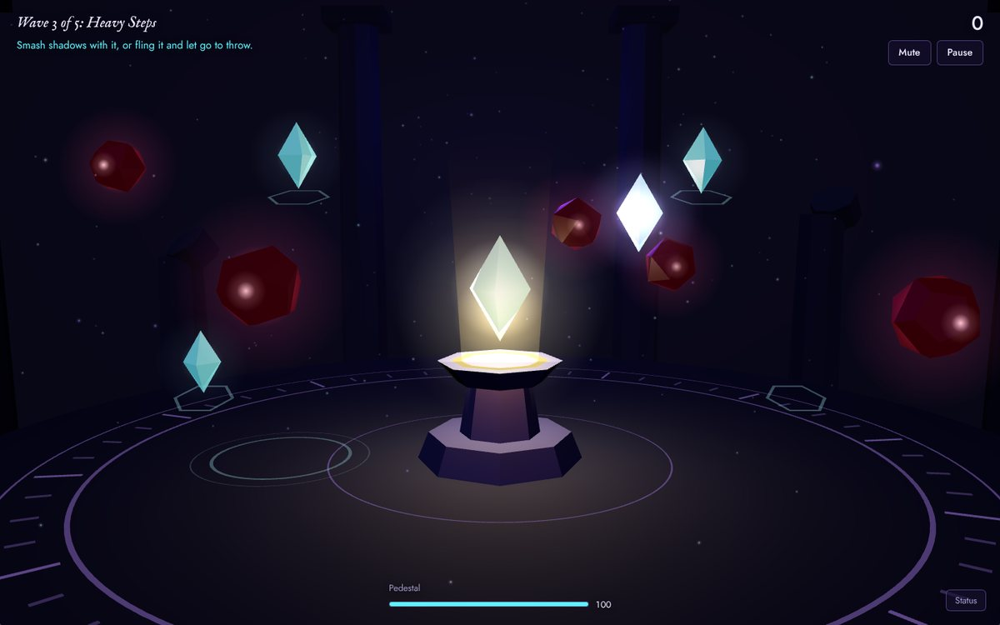
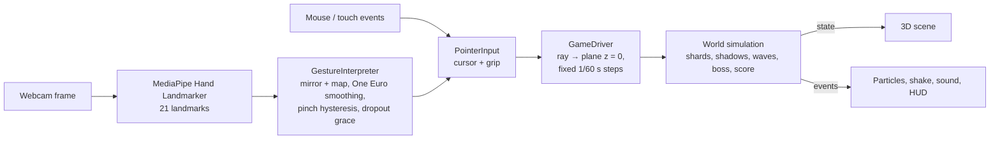

# Arcane — Gesture-Controlled Magic

**Your hands are the magic.** Arcane is a 3D action game you play with your bare hand. Your webcam tracks your index finger as a glowing cursor; pinching your thumb and index finger is the only move you need. Wake an ancient pedestal by carrying its crystal home, then defend it from five waves of shadows: pluck crystal shards out of the air, smash them into the dark or hurl them across the chamber, and finally face the Hollow Eye.

Everything runs in the browser: no installs, no account and no server. Webcam frames never leave your computer, and a mouse mode lets anyone play without a camera.



## Live Demo

**▶ Play: https://arcane-gesture-magic.vercel.app**

Source: https://github.com/dvallabhani/arcane

Click **Play with webcam** and allow camera access, or **Play with mouse**. A full run takes about 5–8 minutes. **Short on time?** Open https://arcane-gesture-magic.vercel.app/?debug, press <kbd>D</kbd>, and use the *Jump to wave* buttons to reach any wave, including the boss.

Built for current desktop browsers; automated tests run in Chromium (Chrome/Edge).

## How It Works

1. **Hand landmarks.** Each webcam frame goes to Google's [MediaPipe Hand Landmarker](https://ai.google.dev/edge/mediapipe/solutions/vision/hand_landmarker), a neural network running in the browser through WebAssembly (and WebGL when available). It returns 21 points on the hand, both as image coordinates and as a 3D estimate in metres.
2. **Cursor.** The index fingertip is mirrored, mapped from camera space to screen space, smoothed, and projected onto an invisible plane in the 3D scene. That point is the violet cursor.
3. **Pinch.** The thumb-to-index distance is divided by the size of the palm, so it doesn't change with distance from the camera. Two thresholds and a short confirmation turn it into a stable "gripping / not gripping" signal.
4. **The game.** Every frame, a pure-TypeScript simulation (`World`) receives just two things: the cursor position and the grip. It runs everything else (grabbing, throwing, shadows, waves, the boss, scoring) and reports events such as `kill` or `pedestal-hit`. The 3D scene draws the world and plays particles and synthesized sound for those events.

Mouse mode writes the same cursor and grip values into the same input, so both control schemes play the identical game.



## Features

Everything listed here is implemented and working.

**Gameplay**
- **Awakening:** carry the heart crystal to the pedestal to start. "Magic Awakened!", a light beam and a gold burst open the battle.
- **Smash:** take a crystal shard from one of four floating wells and ram it into shadows. A shard breaks after three hits, and its well grows a new one.
- **Throw:** flick and release mid-motion to throw a shard. Gentle aim assist and homing make throws forgiving.
- **Ward crystal:** appears after waves 2 and 4. Placing it on the pedestal heals it and raises a shield.
- **Nova crystal:** appears in later waves. Placing it on the pedestal blasts every nearby shadow.
- **Five shadow types:**
  - Wisps drift in.
  - Darts tremble as a warning, then dash.
  - Brutes take three hits.
  - Splitters break into two motes.
  - Motes are the small, fast pieces a splitter leaves behind.
- **The Hollow Eye (final boss):** sways across the chamber, glows before firing dark orbs at the pedestal (which you can shoot or smash down), summons wisps as it weakens, and attacks faster below half health.
- **Score:** combo multiplier (up to ×4) for quick kills, wave bonuses, a flawless-wave bonus and a health bonus at victory. Best score is saved in the browser.
- **Victory and defeat** screens with Play again.

**Hand tracking and controls**
- Webcam hand tracking with MediaPipe, processed locally in the browser.
- One gesture for everything: pinch to grab, keep pinching to carry, open your fingers to release (or throw, if moving).
- Grip and hover use hysteresis, so they never flicker at a threshold.
- Losing your hand during a wave pauses the game; it resumes by itself when the hand returns.
- Switching tabs pauses too. <kbd>Esc</kbd>/<kbd>P</kbd> pause, <kbd>M</kbd> mute, <kbd>D</kbd> status panel.
- A mirrored camera preview shows the tracked hand skeleton.
- Clear camera errors (blocked, no camera, camera busy, insecure page, model download failed), each with Try again and Play with mouse.
- Automatic switch from GPU to CPU hand tracking when the GPU path is slow (software-emulated graphics).
- A mouse/touch mode that plays the same game and never touches the camera.

**Presentation**
- A chamber built entirely from procedural geometry. All glow comes from additive sprites (no post-processing, models or image textures).
- Pooled particle bursts, shockwave rings, screen shake, and a shield bubble.
- Every sound is synthesized in code with the Web Audio API (no audio files), over a low ambient drone, with a mute toggle.
- Responsive layout down to phone size, keyboard focus styles, reduced-motion support, and self-hosted fonts.

## Technologies

| Area | Used |
| --- | --- |
| Language | TypeScript 7 |
| UI | React 19, plain CSS |
| 3D | Three.js r187 via React Three Fiber 9 |
| Computer vision | MediaPipe Tasks Vision 1.2 (`HandLandmarker`, float16 model) |
| Audio | Web Audio API (procedural synthesis) |
| Build | Vite 8 |
| Tests | Vitest 5 (unit), Playwright 1.63 (browser) |
| Lint | oxlint |
| Hosting | Vercel (static site, no backend) |

There is no backend, database, authentication or external AI API. The MediaPipe WebAssembly runtime is bundled with the site; the hand model file is downloaded from Google's official model storage the first time you choose webcam mode.

## How to Play

**With your webcam**

1. Click **Play with webcam** and allow camera access.
2. Raise one hand so the camera can see your palm. The preview in the bottom-left shows what the tracker sees.
3. Point at the large crystal, pinch to pick it up, carry it to the pedestal and open your fingers.
4. When the shadows come, point at a shard in one of the four wells and pinch to take it.
5. Move the shard into shadows to smash them, or flick your hand and open your fingers mid-motion to throw it.
6. Carry green (ward) and orange (nova) crystals to the pedestal to use them.

Tips: about an arm's length from the camera, with your hand lit from the front, works best. The middle 70% of the camera's view covers the whole screen, so you don't need to reach the edges.

**With a mouse, trackpad or touchscreen**

Press and hold to grab, drag to carry or smash, release to drop. Release while still moving to throw.

**Keys:** <kbd>Esc</kbd> or <kbd>P</kbd> pause, <kbd>M</kbd> mute, <kbd>D</kbd> status panel.

## Run Locally

Requires Node.js 22.12 or newer.

```bash
git clone https://github.com/dvallabhani/arcane.git
cd arcane
npm install
npm run dev        # http://localhost:5173  (add ?debug for the jump-to-wave buttons)
```

Browsers allow the camera on `localhost` and on HTTPS sites only.

Other commands:

```bash
npm run build      # type-check and build to dist/
npm run preview    # serve the production build on http://localhost:4173
npm run lint       # oxlint
npm test           # unit tests (Vitest)
npx playwright install chromium   # once, before the browser tests
npm run test:e2e   # browser tests against the production build (Playwright)
```

## Project Structure

```
src/
  game/         game rules and state, independent of rendering and input
    world.ts            the whole simulation: shards, shadows, waves, boss, score
    content.ts          enemy stats and the wave script, as plain data
    constants.ts        layout (pedestal, wells, bounds) and tuning numbers
    input.ts            the shared cursor + grip input both control modes write into
    useMouseControls.ts mouse/touch -> input
    session.ts          the live game objects + actions (start, pause, restart)
    store.ts            tiny state store for the HTML overlay
  vision/       computer vision; the logic files contain no React or Three.js
    handTracker.ts      camera access, MediaPipe setup, throttled detection loop
    gestureInterpreter.ts  landmarks -> cursor + grip (mapping, smoothing, pinch)
    pinch.ts            pinch ratio and hysteresis detector
    mapping.ts          camera coordinates -> screen coordinates (mirroring, margins)
    oneEuroFilter.ts    jitter filter
    cameraErrors.ts     getUserMedia errors -> human messages
    useWebcamSession.ts React hook that runs the whole webcam pipeline
  scene/        Three.js components (chamber, pedestal, crystals, shadows, boss, effects)
  audio/        procedural sound effects (Web Audio API)
  ui/           title screen, HUD, banners, pause and end screens, help dialog
e2e/            Playwright browser tests
public/fonts/   self-hosted fonts (SIL Open Font License)
```

## Technical Implementation

**Hand landmark tracking.** `HandLandmarker` runs in `VIDEO` mode with `numHands: 1`. The detection loop analyses a frame only when the camera has produced a new one, and never more than 30 times per second. MediaPipe and its 14 MB WebAssembly runtime load lazily, only after the player chooses webcam mode. The GPU delegate is tried first. If it can't start, or averages more than 60 ms per frame after warm-up (a sign of software-emulated WebGL), the app switches to the CPU delegate mid-game.

**Pinch recognition.** `ratio = |thumbTip − indexTip| / max(palmLength, palmWidth)`. Palm length is wrist → middle knuckle and palm width is index knuckle → pinky knuckle; taking the larger keeps the measure stable when the hand tilts. The ratio uses MediaPipe's 3D world landmarks, which avoids false pinches when the thumb only *looks* like it touches the index finger in the 2D image. In testing on real photos, one pose read 0.14 in 2D but 0.46 in 3D. A pinch starts below **0.30** and ends above **0.45**, and each change must hold for **2 consecutive frames**.

**Coordinate mapping.** Landmarks arrive in camera-image space (0–1, not mirrored). The x axis is flipped so the cursor moves like a mirror image, and the central 70% of the frame is stretched to fill the screen. The result becomes normalized device coordinates, exactly what mouse events produce. The scene casts a ray from the 3D camera through that point onto a fixed vertical plane (z = 0) that contains all the action, so the whole game is 2D logic in a 3D scene.

**Gesture smoothing.** The fingertip is filtered with a [One Euro filter](https://gery.casiez.net/1euro/): heavy smoothing when the hand is still (no jitter), light smoothing when it moves fast (no lag). Detector dropouts of up to 3 frames are ignored, so one missed frame doesn't drop what you're holding.

**3D object manipulation.** No physics engine. A grab begins only at the *moment* the grip starts while hovering a crystal. A held crystal eases toward the cursor with frame-rate-independent damping, clamped to the play area. On release, the game measures the hand's velocity against the newest sample at least 80 ms old, which works even at low frame rates. Fast releases become throws, with a launch speed of 7–13 units/s, a 30° aim-assist cone and gentle homing.

**Combat and waves.** Shadows steer toward the pedestal with a sideways wobble, and smashes knock them back. Each wave is a timed spawn script in `content.ts`, so balancing means editing numbers, not code. The simulation advances in fixed steps of at most 1/60 s, so game speed stays correct down to 10 fps and fast shards can't skip past a target. Mouse presses and releases are queued and replayed in order, so a click shorter than one frame still counts.

**Objective completion.** Releasing a special crystal within 0.95 units of the socket (crystal *or* cursor position) places it: the heart awakens the pedestal, a ward heals and shields it, a nova clears the area. The run is won when the Hollow Eye's health reaches zero and lost when the pedestal's does.

**Rendering.** Shadows, shards and orbs are fixed pools of meshes updated in place each frame, so spawning never triggers React re-renders. One shared 1,200-particle pool serves every burst. React only re-renders the HTML overlay when a displayed value (score, health, wave) actually changes.

## Testing

**Automated.**
- **59 unit tests** (`npm test`). The game simulation alone has 26:
  - awakening;
  - grabbing, dropping and the drift back to the well;
  - throwing, including aim assist and low frame rates;
  - smashing and shard breakage;
  - every shadow type and the shield;
  - wave progression and bonuses, ward, nova, and the boss's orbs, summons and defeat;
  - combos, defeat, pause, hand loss, and reset.

  The rest cover pinch detection, coordinate mapping, smoothing, the gesture interpreter, camera errors and hints.
- **17 browser tests** (`npm run test:e2e`) play the production build in Chromium with a real mouse:
  - awakening, including an instant drag;
  - dropping, smashing and throwing;
  - pause and resume;
  - defeat with Try again, and victory over the boss;
  - the status panel and the help dialog;
  - camera blocked, missing or busy, and the model failing to download;
  - with a fake camera: tracking starts, and the game pauses itself when no hand is visible during a wave;
  - the title screen never requests the camera.

**Real MediaPipe, synthetic webcam.** During development, the real model was run on photos of real hands fed through Chromium's fake-camera feature. That confirmed hand detection, cursor placement (within ~0.15 world units of the target), hover, hand-loss handling, recovery, and the automatic GPU → CPU switch. A real pinch on a live webcam was verified by hand.

**Checked by hand** (needs a person and a camera):

| # | Scenario | Expected |
| --- | --- | --- |
| 1 | Allow the camera | Preview appears; status panel shows Camera: On |
| 2 | Block the camera | "Camera access is blocked" with Try again / Play with mouse |
| 3 | Raise a hand | Cursor follows the index finger; preview reads "Hand tracked" |
| 4 | Pinch the large crystal, carry it, release over the pedestal | "Magic Awakened!", then Wave 1 |
| 5 | Pinch a shard and move it into a shadow | Shadow bursts, score increases |
| 6 | Flick and open the fingers | Shard flies and curves toward a shadow |
| 7 | Lower the hand during a wave | "Hand lost" pause; raising the hand resumes |
| 8 | Carry a ward or nova to the pedestal | Heal + shield, or a gold blast |

## Challenges and Future Improvements

**Challenges solved**

- *Flicker at thresholds.* A single pinch threshold toggled every frame near the boundary. Fixed with hysteresis, 2-frame confirmation, and the same idea for hover.
- *Mirrored coordinates.* The camera image isn't mirrored, but people expect a mirror. The mapping flips x in exactly one place, and a unit test pins the direction.
- *Reach.* Mapping the full camera frame forced players to push their hand out of view to reach the edges. The central 70% of the frame now covers the screen.
- *Slow "GPU".* Without hardware acceleration, MediaPipe's GPU path runs on emulated WebGL at 1–2 fps and freezes the page. The app now times detection and switches to the CPU path automatically.
- *Clicks shorter than a frame.* Input was sampled once per frame, so a quick press-move-release could vanish. Found while testing the live site. Presses and releases are now queued and replayed in order.
- *Slow motion on slow machines.* Clamping each frame's time step made the game run at a quarter speed at 8 fps. Fixed by splitting each frame into 1/60 s substeps.
- *Throws lost at low frame rates.* Velocity measured over a fixed 0.1 s window saw no motion when frames arrived more than 0.1 s apart. It's now measured against the newest sample at least 80 ms old.
- *2D vs 3D distance.* Image-space pinch distances produced false pinches when the thumb overlapped the index finger in the picture. 3D world landmarks fixed it.

**Known limitations**

- A closed fist also brings the index fingertip close to the thumb, so it registers as a grip.
- Hand detection runs on the main thread. On slow machines it competes with rendering.
- The hand model downloads from Google's model storage. If that host is blocked on a network, webcam mode shows a "could not load" message and mouse mode still works.
- Difficulty is tuned for webcam play; mouse play is easier.

**Future ideas (not implemented)**

- More spells mapped to distinct gestures (open palm to repel, fist to pull, two hands for a barrier).
- More chambers with new layouts, hazards and bosses.
- Using hand depth to push and pull objects toward and away from the camera.
- Running MediaPipe in a Web Worker so tracking never competes with rendering.
- Per-player calibration of pinch thresholds and reach.
- Separate difficulty settings for mouse and webcam play.

## Privacy

Webcam frames are analysed inside your browser and are never uploaded, recorded or stored. The camera turns on only after you choose webcam mode, and turns off when you switch to mouse mode or return to the menu.

## Credits

- Hand tracking: [MediaPipe](https://github.com/google-ai-edge/mediapipe) by Google (Apache 2.0)
- Fonts: [IM Fell English](https://fonts.google.com/specimen/IM+Fell+English) by Igino Marini and [Jost](https://fonts.google.com/specimen/Jost) by Owen Earl, both under the SIL Open Font License (see `public/fonts/`)
- One Euro filter: Casiez, Roussel and Vogel, *1€ Filter*, CHI 2012
