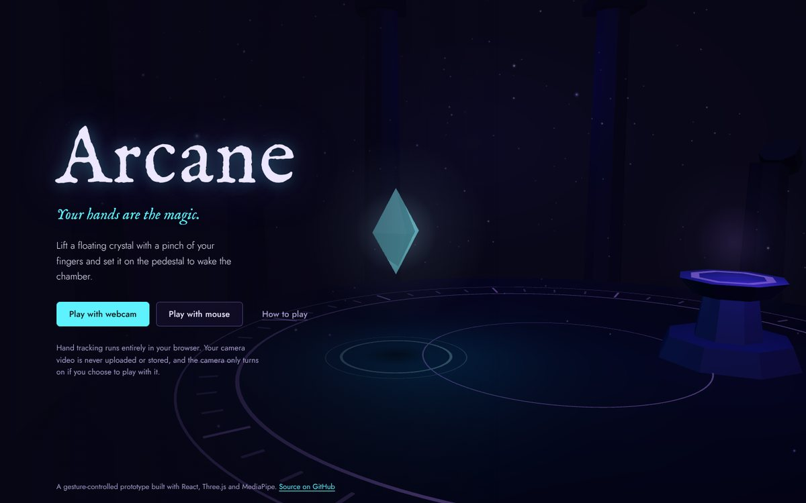
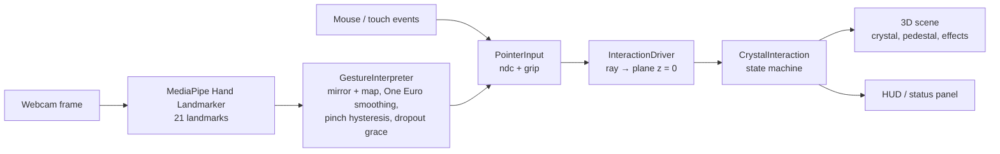

# Arcane — Gesture-Controlled Magic

**Your hands are the magic.** Arcane is a small browser-based 3D experience you control with your bare hand. Your webcam tracks your index finger as a glowing cursor. Pinch your thumb and index finger to pick up a floating crystal, carry it across a ruined chamber, and let go over the pedestal to wake it up.

It is deliberately one complete interaction, not a whole game: the point is to make hand-tracked object manipulation feel reliable and satisfying in a browser, with no installs and no server.



## Live Demo

**▶ Live site:** _added after deployment_

Built for current desktop browsers; automated tests run in Chromium (Chrome/Edge). Click **Play with webcam** and allow camera access, or click **Play with mouse** if you don't have a camera. No account or install is needed.

## How It Works

1. **Hand landmarks.** Each webcam frame is passed to Google's [MediaPipe Hand Landmarker](https://ai.google.dev/edge/mediapipe/solutions/vision/hand_landmarker), a neural network that runs in the browser through WebAssembly (and WebGL when available). It returns 21 points on the hand (wrist, knuckles, fingertips) both as image coordinates and as a 3D estimate in metres.
2. **Cursor.** The index fingertip (landmark 8) is mirrored, mapped from camera space to screen space, smoothed, and projected onto an invisible plane in the 3D scene. That point is the violet cursor.
3. **Pinch.** The distance between the thumb tip (4) and index tip (8) is divided by the size of the palm, so the measurement doesn't change when your hand is closer to or farther from the camera. Two thresholds plus a short confirmation turn that number into a stable "pinching / not pinching" signal.
4. **Crystal logic.** A small state machine (`idle → hovered → grabbed → placed`) decides what happens: hover over the crystal, start a pinch to grab it, move to carry it, open your fingers to drop it. Dropping it close enough to the pedestal snaps it into place and triggers the completion effect.

Mouse mode writes the same two values (cursor position and "grip") into the same input object, so both control schemes run through the identical game logic.



## Features

Everything listed here is implemented and working:

- A 3D chamber built entirely from procedural geometry: stone platform, engraved rune dial, ruined pillars, floating crystal and pedestal
- Webcam hand tracking with MediaPipe, processed locally in the browser
- A violet cursor that follows your index fingertip, with a rune ring that tightens while you pinch
- Pinch-to-grab, move-to-carry and open-to-release, with hysteresis so the grip doesn't flicker
- Crystal states with visual feedback: idle (soft glow), hovered (brighter, larger), grabbed (follows the cursor), placed (turns gold)
- A drop hint: the pedestal's runes pulse while you carry the crystal over it
- Completion: the crystal glides into the socket, the pedestal turns gold, a light beam rises, a shockwave sweeps the floor, gold sparks burst out, and **"Magic Awakened!"** appears
- Reset at any time (button or <kbd>R</kbd>), plus Play again after completion
- A mouse/touch mode that never touches the camera
- A mirrored camera preview with the tracked hand skeleton drawn on top
- A small status panel (button or <kbd>D</kbd>) showing camera, hand, pinch ratio, crystal state and tracking fps
- Clear camera errors (blocked, no camera, camera busy, insecure page, model download failed), each with Try again and Play with mouse
- If the hand leaves the frame, the cursor hides, any held crystal is dropped, and tracking resumes automatically when the hand returns
- Automatic switch from GPU to CPU hand tracking when the GPU path turns out to be slow (software-emulated graphics)
- Responsive layout down to phone size; keyboard focus styles; reduced-motion support

## Technologies

| Area | Used |
| --- | --- |
| Language | TypeScript 7 |
| UI | React 19, plain CSS |
| 3D | Three.js r187 via React Three Fiber 9 |
| Computer vision | MediaPipe Tasks Vision 1.2 (`HandLandmarker`, float16 model) |
| Build | Vite 8 |
| Tests | Vitest 5 (unit), Playwright 1.63 (browser) |
| Lint | oxlint |
| Hosting | Vercel (static site, no backend) |

There is no backend, database, authentication or external AI API. The MediaPipe WebAssembly runtime is bundled with the site; the hand model file is downloaded from Google's official model storage the first time you choose webcam mode.

## How to Play

**With your webcam**

1. Click **Play with webcam** and allow camera access.
2. Raise one hand so the camera can see your palm. The preview in the bottom-left shows what the tracker sees.
3. Point at the crystal with your index finger. It brightens when the cursor is close enough.
4. Pinch your thumb and index finger together to grab it.
5. Keep pinching and move your hand over the pedestal. The pedestal's runes pulse when you're in range.
6. Open your fingers to let go.

Tips: about an arm's length from the camera with your hand lit from the front works best. You don't need to reach the edges of the camera's view; the middle 70% of the frame covers the whole screen.

**With a mouse, trackpad or touchscreen**

Press on the crystal, drag it over the pedestal and release.

**Keys:** <kbd>R</kbd> reset, <kbd>D</kbd> status panel, <kbd>Esc</kbd> close dialogs.

## Run Locally

Requires Node.js 22.12 or newer.

```bash
git clone https://github.com/dvallabhani/arcane.git
cd arcane
npm install
npm run dev        # http://localhost:5173
```

Browsers allow the camera on `localhost` and on HTTPS sites only.

Other commands:

```bash
npm run build      # type-check and build to dist/
npm run preview    # serve the production build on http://localhost:4173
npm run lint       # oxlint
npm test           # unit tests (Vitest)
npx playwright install chromium   # once, before the browser tests
npm run test:e2e   # browser tests against the production build (Playwright)
```

## Project Structure

```
src/
  game/         rules and state, independent of rendering and input
    interaction.ts      crystal state machine (idle / hovered / grabbed / placed)
    constants.ts        positions, radii and speeds
    input.ts            the shared PointerInput both control modes write into
    useMouseControls.ts mouse/touch -> PointerInput
    session.ts          the live game objects + actions (reset, start, switch mode)
    store.ts            tiny state store for the HTML overlay
  vision/       computer vision, no React or Three.js inside the logic files
    handTracker.ts      camera access, MediaPipe setup, throttled detection loop
    gestureInterpreter.ts  landmarks -> cursor + grip (mapping, smoothing, pinch)
    pinch.ts            pinch ratio and hysteresis detector
    mapping.ts          camera coordinates -> screen coordinates (mirroring, margins)
    oneEuroFilter.ts    jitter filter
    cameraErrors.ts     getUserMedia errors -> human messages
    useWebcamSession.ts React hook that runs the whole webcam pipeline
  scene/        Three.js components (chamber, crystal, pedestal, cursor, particles)
  ui/           title screen, HUD, how-to-play dialog, webcam panel, status panel
e2e/            Playwright browser tests
public/fonts/   self-hosted fonts (SIL Open Font License)
```

## Technical Implementation

**Hand landmark tracking.** `HandLandmarker` runs in `VIDEO` mode with `numHands: 1`. The detection loop (`HandTracker`) runs on `requestAnimationFrame` but only analyses a frame when the camera has produced a new one, and never more than 30 times per second. MediaPipe and its 14 MB WebAssembly runtime are loaded lazily, only after the player chooses webcam mode. The GPU delegate is tried first; if it can't start, or if it averages more than 60 ms per frame after warm-up (a sign of software-emulated WebGL), the app switches to the CPU delegate without interrupting play.

**Pinch recognition.** `ratio = |thumbTip − indexTip| / max(palmLength, palmWidth)`. Palm length is wrist → middle-finger knuckle and palm width is index knuckle → pinky knuckle; taking the larger keeps the measure stable when the hand tilts. The ratio is computed from MediaPipe's 3D world landmarks, which avoids false pinches when the thumb only *looks* like it touches the index finger in the 2D image. In testing on real photos, one "call me" pose read 0.14 in 2D but 0.46 in 3D. A pinch starts below **0.30** and ends above **0.45**, and each change must hold for **2 consecutive frames**. Between those thresholds the state doesn't change, which removes flicker.

**Coordinate mapping.** Landmarks arrive in camera-image space (0–1, origin top-left, not mirrored). The x axis is flipped so the cursor moves like a mirror image, the central 70% of the frame is stretched to fill the screen (so the hand doesn't leave the camera to reach the edges), and the result is converted to normalized device coordinates. Mouse events produce the same coordinates. The scene then casts a ray from the 3D camera through that point and intersects it with a fixed vertical plane (z = 0) that contains the crystal and pedestal, so all game logic is 2D.

**Gesture smoothing.** The fingertip is filtered with a [One Euro filter](https://gery.casiez.net/1euro/): heavy smoothing when the hand is still (no jitter), light smoothing when it moves fast (no lag). Short detector dropouts (up to 3 frames) are ignored, so a single missed frame doesn't drop the crystal.

**3D object manipulation.** No physics engine. A grab only begins on the *moment* the grip starts while the cursor is over the crystal (sweeping across it while already pinching does nothing). While grabbed, the crystal eases toward the cursor with frame-rate-independent exponential damping, clamped to the visible play area. Hover uses two radii (enter at 0.72, leave at 0.98 units) for the same anti-flicker reason as the pinch.

**Objective completion.** On release, if the crystal is within 0.95 units of the pedestal's socket it becomes `placed`: input is ignored and it glides into the socket. That state drives every completion effect (gold tint, rune ring, beam, shockwave, spark burst, message). Reset restores the start state, and a pinch still held during reset can't instantly re-grab.

**Rendering.** All glow is faked with additive-blended sprites using a radial gradient generated on a canvas at runtime: no post-processing, models or image textures. Per-frame data (positions, cursor) lives in plain objects read inside the render loop, and React only re-renders the HTML overlay when a displayed value actually changes.

## Testing

**Automated.** 48 unit tests (`npm test`) cover the crystal state machine, pinch ratio and hysteresis, coordinate mapping, the One Euro filter, the gesture interpreter (dropouts, hand loss and recovery), camera error mapping and the on-screen hints. 11 browser tests (`npm run test:e2e`) run the production build in Chromium:

- mouse drag onto the pedestal completes the objective
- releasing elsewhere leaves the crystal there
- reset and play again work
- the status panel works
- the How to play dialog opens and closes
- camera permission denied, no camera and camera busy each show the right message, with a working mouse fallback
- the model failing to download is handled
- with a fake camera, tracking starts, reports that no hand is visible, and turns the camera off when switching to mouse
- the title screen never requests the camera

**Real MediaPipe, synthetic webcam.** During development, the real model was also run on photos of real hands fed through Chromium's fake-camera feature. That confirmed hand detection, cursor placement (the fingertip landed within ~0.15 world units of its target), hover, hand-loss handling, recovery, and the automatic GPU → CPU switch.

**Needs a person.** An actual pinch on a live camera can't be automated with photos, so these are checked by hand on the deployed site:

| # | Scenario | Expected |
| --- | --- | --- |
| 1 | Allow the camera | Notice, then preview appears; status panel shows Camera: On |
| 2 | Block the camera | "Camera access is blocked" with Try again / Play with mouse |
| 3 | No webcam | "No camera found" |
| 4 | Raise a hand | Cursor appears; preview reads "Hand tracked" |
| 5 | Lower the hand out of view | Cursor fades; status reads "No hand in view" |
| 6 | Pinch over the crystal | Ring tightens, crystal follows; panel shows Pinching / Grabbed |
| 7 | Open the fingers | Crystal stays where released |
| 8 | Carry while pinching | Crystal follows smoothly; pedestal pulses when in range |
| 9 | Release over the pedestal | Snap, gold beam, sparks, "Magic Awakened!" |
| 10 | Reset | Crystal returns; effects clear |
| 11 | Hand leaves while holding | Crystal is dropped; tracking resumes when the hand returns |

## Challenges and Future Improvements

**Challenges (solved in this version)**

- *Flicker at thresholds.* A single pinch threshold made the grip toggle every frame near the boundary. Fixed with hysteresis (two thresholds), 2-frame confirmation, and the same idea for hover.
- *Mirrored coordinates.* The camera image is not mirrored but people expect a mirror. The mapping flips x once, in one place, and a unit test pins the direction.
- *Reach.* Mapping the full camera frame to the screen forced people to push their hand out of view to reach the edges. The central 70% of the frame now covers the screen.
- *Slow "GPU".* On machines without hardware acceleration, MediaPipe's GPU path runs on emulated WebGL at about 1–2 fps and freezes the page. The app now times detection and switches to the CPU path automatically.
- *2D vs 3D distance.* Image-space pinch distances produced false pinches when the thumb overlapped the index finger in the picture. 3D world landmarks fixed it.

**Known limitations**

- A closed fist also brings the index fingertip close to the thumb, so it registers as a grab.
- The cursor is the index fingertip, which moves slightly toward the thumb as you pinch. Generous hover radii absorb this, but very small targets would need a different pick point.
- Hand detection runs on the main thread. On slow machines it competes with rendering.
- The hand model is downloaded from Google's model storage. If that host is blocked on a network, webcam mode shows a "could not load" message and mouse mode still works.

**Future ideas (not implemented)**

- More spells, each mapped to a gesture (open palm to push, fist to pull, two-hand gestures for portals)
- Multi-step puzzles: several crystals, colour matching, pedestals that open new chambers
- Depth: using the hand's distance from the camera to move objects toward or away from the player
- Running MediaPipe in a Web Worker to keep rendering perfectly smooth
- Per-player calibration of the pinch thresholds and reach area
- Sound design for grab, release and completion

## Privacy

Webcam frames are analysed inside your browser and are never uploaded, recorded or stored. The camera only turns on after you choose webcam mode and turns off when you switch to mouse mode or return to the menu.

## Credits

- Hand tracking: [MediaPipe](https://github.com/google-ai-edge/mediapipe) by Google (Apache 2.0)
- Fonts: [IM Fell English](https://fonts.google.com/specimen/IM+Fell+English) by Igino Marini and [Jost](https://fonts.google.com/specimen/Jost) by Owen Earl, both under the SIL Open Font License (see `public/fonts/`)
- One Euro filter: Casiez, Roussel and Vogel, *1€ Filter*, CHI 2012
